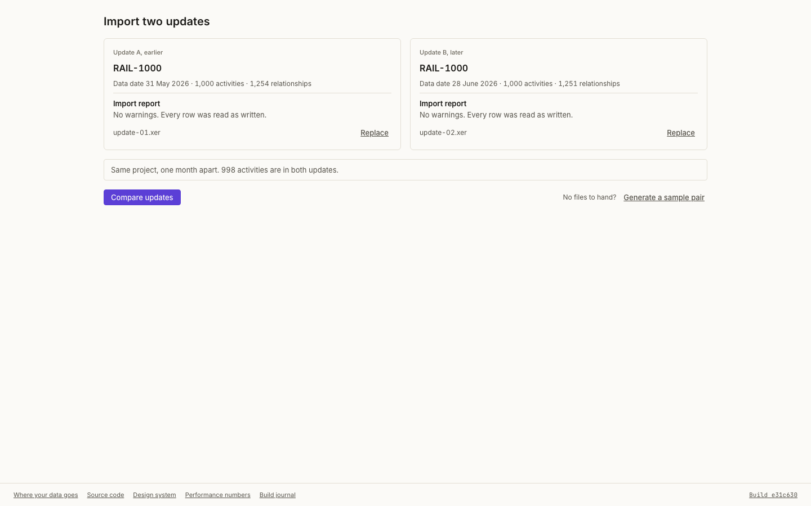
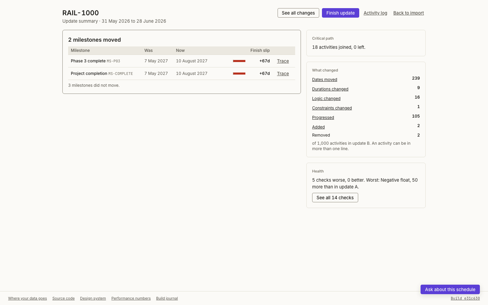
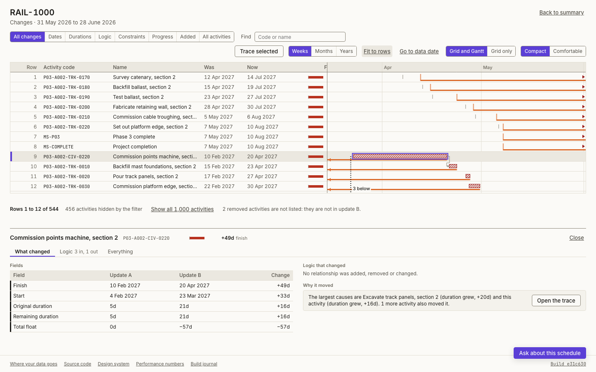
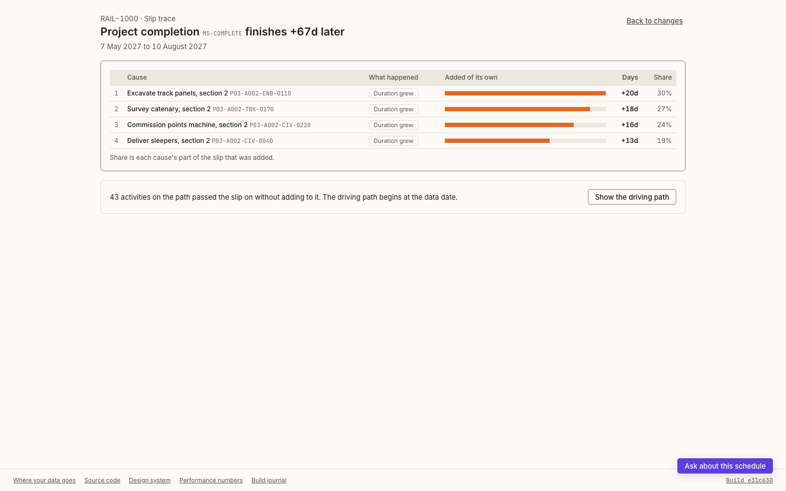
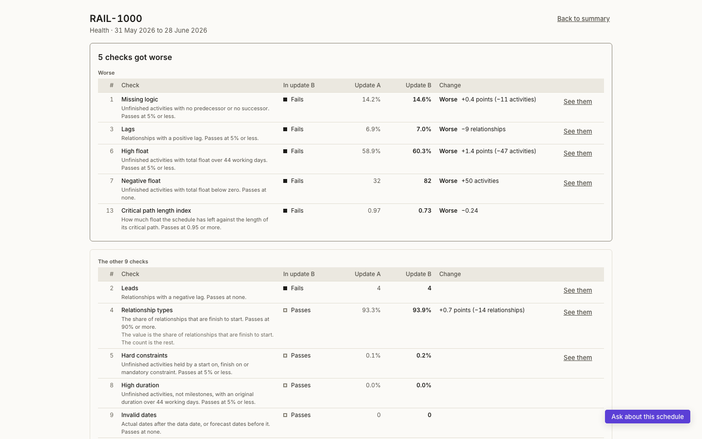
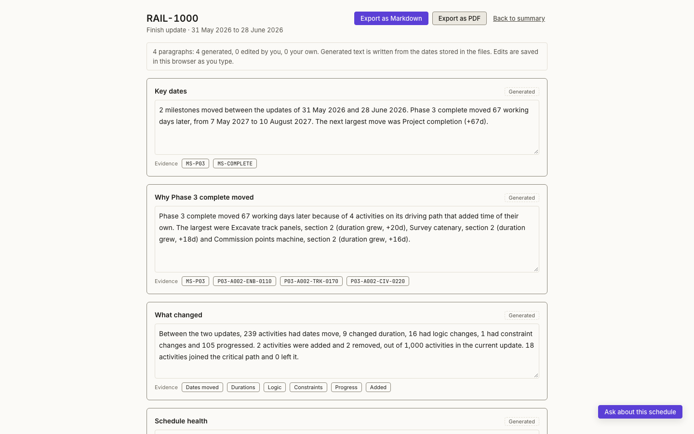
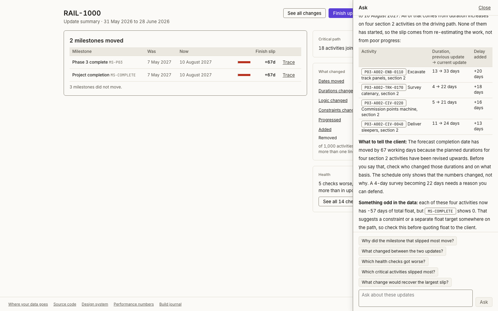

# Slip

A review workspace for the monthly update of a large construction or infrastructure schedule. Load two updates of the same Primavera P6 schedule, update N and update N+1, and Slip shows what changed, why key dates slipped, whether the schedule can still be trusted, and helps write the narrative for the report.

- **The app:** https://slip.usmankadai.dev. Choose "Generate a sample pair" if you have no XER files to hand.
- **The design system (Storybook):** https://slip-design-system.usmankadai.dev
- **How it was built, and who decided what:** [docs/journal.md](docs/journal.md)

It is built for schedules of 350,000 to 1,000,000 activities, the size of a large programme, and runs in the browser: your files are never uploaded.

## A 60-second tour

**1. Import two updates.** Drop last month's and this month's XER files. Each is read in a worker, with progress in rows and bytes, and a report of anything Slip had to repair, grouped by what it means for the answer.



**2. The summary leads with the milestones that moved.** Each has its old and new finish, the slip in working days, and a link to trace it. The rail says what else changed and how the schedule's health moved.



**3. Every change, in a grid and a Gantt.** A windowed grid of every activity with the Gantt beside it: each bar is this update, with a line back to where it finished last month. Select an activity and its logic is drawn, its driving path heavy, and the drawer below says which fields changed and why it moved.



**4. Why a date slipped.** The trace walks back along the driving path and ranks the activities that added time of their own, with what happened to each and its share of the slip.



**5. Can the schedule be trusted.** The 14 DCMA checks for both updates side by side, what got worse first, and every failing activity a click away.



**6. Finish the update.** A narrative written from the comparison, every claim carrying the activities it rests on. Edit it, add your own paragraphs, and export it as Markdown or PDF.



**7. Ask about it.** An assistant that looks things up with the same tools as the screens. Type `#` to name an activity by its code or name. It cites activities, and a code it did not see in its own tool results is marked unverified. It can propose a change, which you approve or reject; both are logged.



## How it performs

Measured by `pnpm perf` on the release build in headless Chromium, on an Apple M3 with 16GB, median of 5 runs. Full tables and how each figure is taken: [docs/perf.md](docs/perf.md).

|                                                  | 100,000 | 350,000 | 1,000,000 |
| ------------------------------------------------ | ------: | ------: | --------: |
| Import one file, start to holding the schedule   |   0.37s |   1.32s |     3.66s |
| Drop both files to the summary's answer          |   0.97s |   2.13s |     5.67s |
| Critical path calculation, one update            |   0.07s |   0.14s |     0.38s |
| Compare the two updates                          |   0.09s |   0.30s |     1.02s |
| Scroll the grid and Gantt, 95th percentile frame |   3.4ms |   2.1ms |     2.1ms |
| Memory with both updates loaded                  |    34MB |   113MB |     319MB |

No task blocks the main thread for more than 50ms during an import or a scroll. Every figure is within the budget in [the performance spec](docs/spec/performance.md). The app's initial JavaScript is 146KB gzipped.

`Shift+P` in the app shows the same kind of numbers live on your own machine.

## Where your data goes

Your XER files are never uploaded. They are read in your browser, and the parsed schedules, your edits, the activity log and the narrative are kept in your browser's storage on your computer.

The assistant is the one exception. In **live** mode, which the public site uses, your question and the specific rows the assistant asks for to answer it (activity codes, names and dates) are sent through Slip's server to Anthropic. The server passes them on and does not store them. A notice says this before your first live question, and you can choose scripted answers instead. In **scripted** mode nothing about your schedule leaves the browser.

The full table, with what holds it true, is in the app under "Where your data goes" and in [docs/data-flow.md](docs/data-flow.md). A test keeps the two the same.

## Known limits

- **Retained logic only.** Slip recalculates with retained logic. A file scheduled with progress override or actual dates still imports, with a warning that recalculated dates may differ from P6's.
- **Calendars are simplified:** working weekdays and daily hours, and listed holidays. See [D18](docs/decisions/D18-cpm-rules-and-simplifications.md).
- **Not yet checked against real P6 exports.** The engine matches the synthetic generator on every date and float value, but its match rate against dates P6 itself calculated is still to be measured, and needs real files.
- **No export back to XER.** The narrative exports as Markdown or PDF. The PDF uses Windows Latin fonts, so names in other scripts print as a question mark; the Markdown keeps them.
- **Desktop browsers, 1280px and wider.** Measured in Chromium only.
- **Not built yet:** error reporting, WBS mentions in the assistant, and a setting to keep activity names from the assistant.

## How it is built

A pnpm monorepo in strict TypeScript.

| Part              | What it is                                                                                                                   |
| ----------------- | ---------------------------------------------------------------------------------------------------------------------------- |
| `packages/xer`    | A streaming XER parser that writes a columnar schedule format: typed arrays, transferred between threads without copying     |
| `packages/engine` | Critical path, the comparison of two updates, the slip trace and the 14 DCMA checks, as pure functions; runs in a worker     |
| `packages/gen`    | A synthetic schedule generator with known answers, from 1,000 to 1,000,000 activities, used by the tests and the sample pair |
| `packages/agent`  | The assistant's tools, their limits, the citation check and the shapes an answer may take                                    |
| `packages/ui`     | The design system: tokens, components with a contract each, and `AGENTS.md`                                                  |
| `apps/web`        | The React app: a windowed grid and a canvas Gantt, written for Slip with no grid or Gantt library                            |
| `apps/api`        | A small Hono server that streams the assistant's answers from the Anthropic API; it keeps no state                           |

Schedules never enter React state: the screens ask the engine worker for the rows on screen.

## A design system for coding agents

Most of Slip's code was written by an AI coding agent working from the spec. The design system is built so that an agent writing UI gets told when it goes wrong, not trusted to remember:

- [`packages/ui/AGENTS.md`](packages/ui/AGENTS.md): the rules for agents, which of them are checked and how, and every component's use in one line.
- Lint rules that fail on a raw colour or raw spacing outside the tokens.
- A check that every screen has stories for loading, empty, error and populated.
- axe on every Storybook story, failing on any serious or critical WCAG 2.2 AA fault.
- A screenshot of every story in both densities, compared in CI inside the official Playwright image.

[docs/agent-experiment/](docs/agent-experiment/README.md) is a small experiment: the same three UI tasks done with and without these rules, and what the checks caught.

## Run it

Needs Node 24 and pnpm (`corepack enable` provides the version pinned in `package.json`).

```bash
pnpm install
```

```bash
pnpm dev
```

```bash
pnpm check
```

`pnpm check` runs formatting, lint, types, every unit test, both builds, axe on every story and the secrets check. `pnpm perf` runs the performance suite, and `pnpm visual` the screenshot suite, which needs Docker.

### The assistant

Without configuration the assistant gives scripted answers. To run it live locally, copy `.env.example` to `.env`, set `AGENT_MODE=live`, `ANTHROPIC_API_KEY` and `ANTHROPIC_MODEL`, and start the server alongside `pnpm dev`:

```bash
pnpm --filter @slip/api dev
```

On Vercel the server runs as functions under `/api` in the app's own project. Live mode is on when these are set in the project's environment variables: `AGENT_MODE=live`, `ANTHROPIC_API_KEY`, `ANTHROPIC_MODEL`, `AGENT_EFFORT`, `APP_ORIGIN`, `AGENT_DAILY_CALL_CAP`, and `UPSTASH_REDIS_REST_URL` and `UPSTASH_REDIS_REST_TOKEN` so the limits hold across instances.

Set a spending limit on the API key in the Anthropic console. The server limits questions per visitor and model calls per day, but the limit on the key is the final backstop.

## Who did what

Usman decided the product, its scope and the spec, and chose every screen's layout from options drawn for him: eleven design explorations, each with three options, in [docs/design/explorations/](docs/design/explorations/). The visual identity was accepted as first proposed, without alternatives ([D16](docs/decisions/D16-visual-identity.md)). An AI coding agent (Claude) wrote the code, the tests and most of the documentation, drew the options, and made the engineering decisions recorded in [docs/decisions/](docs/decisions/README.md). The journal records the split for every step, including where Usman accepted a recommendation rather than choosing for his own reasons.

## Where things are

- [CLAUDE.md](CLAUDE.md): the rules every change follows, and a map of the spec
- [docs/spec/](docs/spec/): the detailed spec
- [docs/decisions/](docs/decisions/README.md): decisions and their reasons
- [docs/design/](docs/design/): low-fidelity flows and design explorations
- [docs/perf.md](docs/perf.md) and [docs/evals.md](docs/evals.md): published performance and assistant evaluation results
